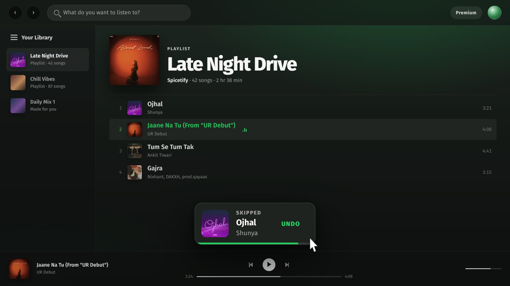

# Undo Skip


A [Spicetify](https://spicetify.app/) extension that catches accidental skips.
When a track change looks like a manual forward skip, a toast appears with an
**Undo** button that takes you back to the previous track at the exact position
you left it.



## Features

- **Undo toast** after an accidental forward skip, with artwork, track, artist,
  and a 7 second drain bar.
- **Exact position restore** — the previous track resumes where it was, not
  from the beginning. The queue and context are preserved when Spotify's
  history still has the track.
- **Paused playback stays paused** after restoring.
- **`Ctrl+Shift+Z`** undoes the last skip while it is still pending (30 seconds),
  even after the toast has disappeared.
- **Profile-menu toggle** — *Undo skip toast* — persisted in local storage.
- **No false alarms** on natural track endings, crossfades, ads, context
  changes, or backwards navigation.

## Install

### Manual

```bash
cp undo-skip.js ~/.config/spicetify/Extensions/
spicetify config extensions undo-skip.js
spicetify apply
```

`spicetify apply` restarts Spotify.

### Direct download

```bash
curl -fsSL \
  https://raw.githubusercontent.com/Ashishranjan980/spicetify-undo-skip/main/undo-skip.js \
  -o ~/.config/spicetify/Extensions/undo-skip.js

spicetify config extensions undo-skip.js
spicetify apply
```

### Uninstall

```bash
spicetify config extensions undo-skip.js-
spicetify apply
```

## Usage

Skip a track mid-playback. The toast appears immediately:

- Click **Undo** to return to the previous track at the saved position.
- Or press **`Ctrl+Shift+Z`** for up to 30 seconds after the skip.
- Toggle the extension from your profile menu under **Undo skip toast**.

Nothing happens automatically: the new track keeps playing until you undo.

## How it works

- `songchange` fires *after* Spotify has switched to the new track, so the old
  position has to be captured continuously. A rolling snapshot is sampled from
  `onprogress` (roughly every 100 ms while playing), `onplaypause`, and a 400 ms
  interval for paused playback.
- Undo first uses Spotify's own history (`Player.back()`), which preserves the
  queue and context. If the history is gone, it jumps back into the original
  context with `skipTo` + `seekTo`, and finally falls back to playing the track
  on its own.
- The restore retries the seek because the player can ignore a seek issued
  while the previous track is still loading.

## Skip detection

A toast is shown only when all of these hold:

- the previous track is different from the new one;
- the playback context is the same (starting another album/playlist is not a
  skip);
- the change is not a backwards navigation (clicking an earlier row or the
  previous button — when shuffle is off);
- the old track was not within its final ~12 seconds (also covers Spotify's
  maximum 12 s crossfade, where a natural transition happens before the track
  duration). For tracks shorter than 80 s the window shrinks to 15% of the
  duration, with a 3 s floor;
- neither track is an ad.

## Development

No build step. The extension is a single plain-JS file.

```bash
# Logic tests run in Node with a fake Spicetify + DOM.
npm test

# Live reload on save (restarts Spotify once with the remote debugger).
spicetify watch -e
```

After editing, also copy the file into `~/.config/spicetify/Extensions/` —
that is the file `watch` monitors.

### Project layout

```
undo-skip.js              the extension
manifest.json             Spicetify Marketplace metadata
assets/preview.png        Marketplace preview image
test/undo-skip.test.mjs   dependency-free smoke tests
```

## Limitations

- Local client only. Playback controlled from another Connect device may fire
  `songchange` locally without a meaningful history to walk back through; the
  fallbacks still try to play the track.
- The queue is preserved in the normal case, but if Spotify's history is gone,
  the last-resort fallback plays the track standalone.
- A skip in the last few seconds of a track intentionally does not toast, so
  natural transitions and crossfades stay quiet.

## License

[MIT](LICENSE)
